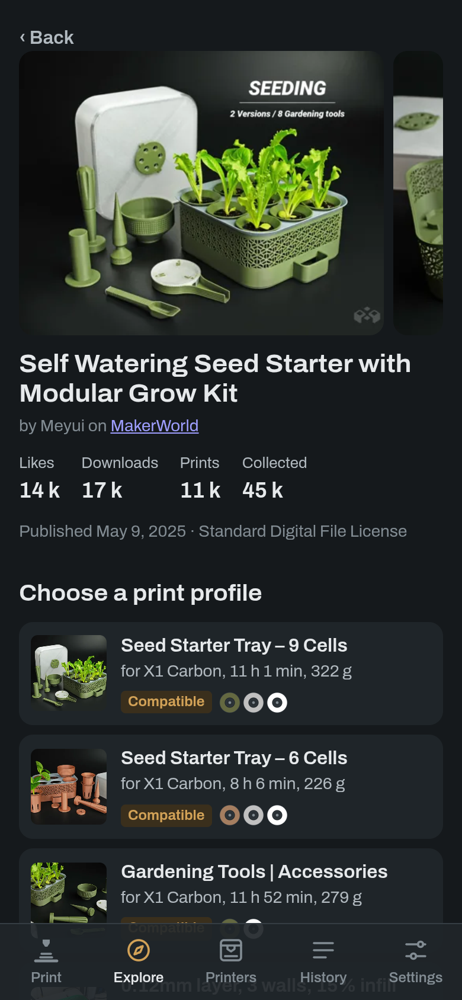
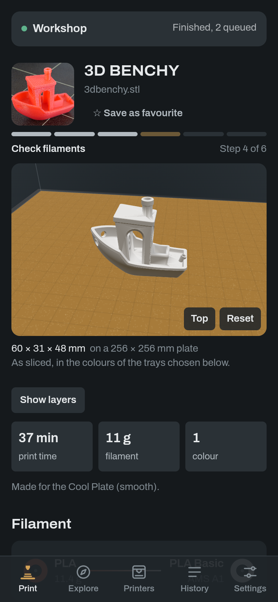
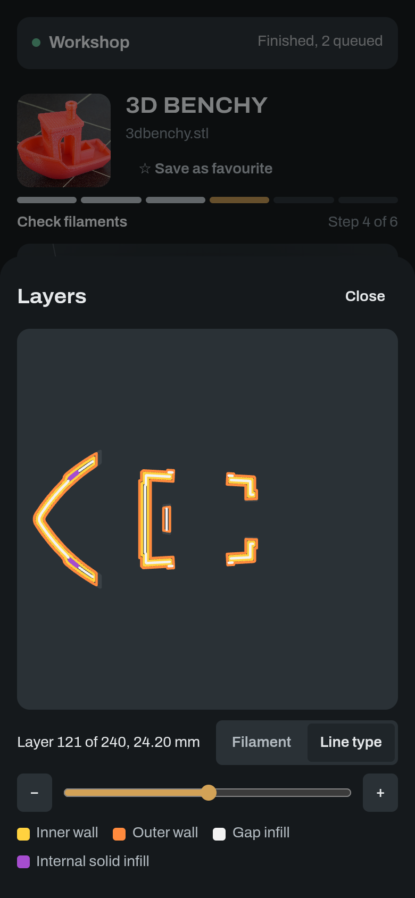
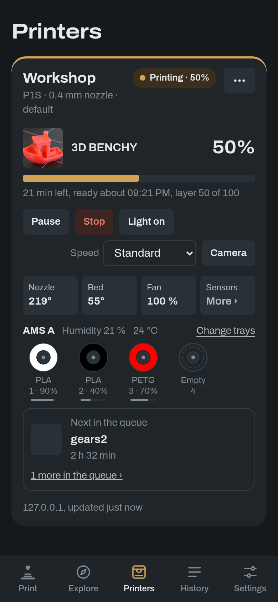
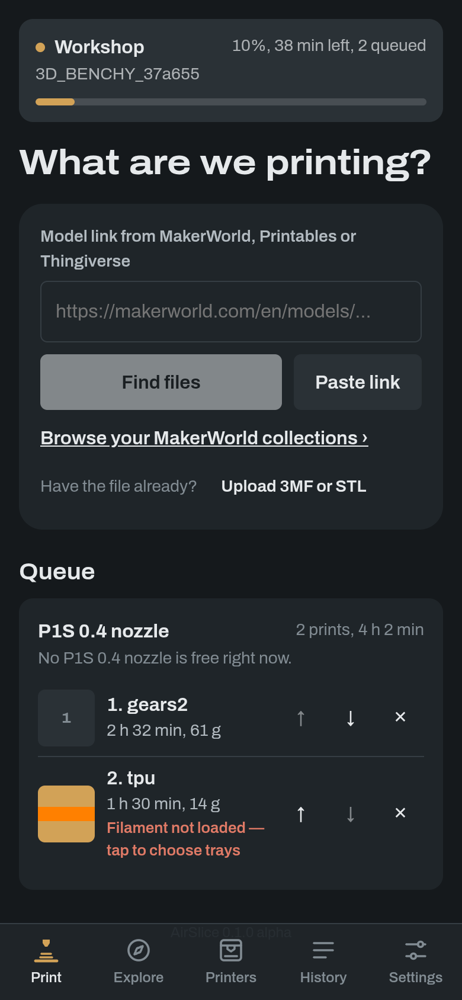
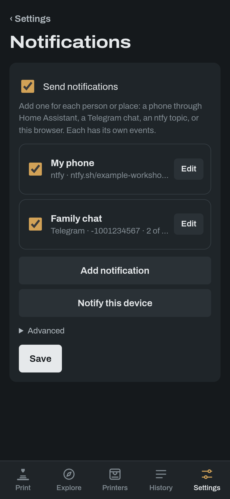

# AirSlice

Print models from **MakerWorld**, **Printables** and **Thingiverse** on a Bambu Lab printer that has **no internet access**, from your phone.

Paste or share a model link. AirSlice shows the model, you pick a print profile and a plate, and it slices with OrcaSlicer on your server, matches the filament to what's loaded in your AMS, uploads the file and starts the print. The printer only ever talks to AirSlice on your local network.

```
 phone ──(home network, VPN or HTTPS)──▶ AirSlice ──LAN──▶ printer (LAN Only)
                                            │  downloads models from MakerWorld / Printables / Thingiverse
                                            │  slices with OrcaSlicer
                                            └─ uploads over FTPS, starts and follows the print over MQTT
```

<p align="center">
  
  
  
</p>
<p align="center">
  
  
  
</p>

> **Alpha.** AirSlice works day to day on a P1S, but other printer models haven't been tried yet (see [Printers](#printers)). Expect rough edges, and send **Settings → About → Copy diagnostics** when something goes wrong.

## Features

- **Find models**: paste a MakerWorld, Printables or Thingiverse link, browse your MakerWorld collections under **Explore**, or upload a 3MF, STL, OBJ or STEP file. A model page shows pictures, description and every print profile with time and weight.
- **Slice on the server**: with the file's own settings when it was made for your printer, otherwise with your printer's OrcaSlicer profile. Pre-sliced `.gcode.3mf` files go straight through. Quick settings (layer height, walls, infill, supports, brim) and presets.
- **Filament**: matched to the AMS trays by material and colour, adjustable before printing. Trays can be edited, re-read and linked to Spoolman.
- **Plates**: 3D preview at real size in the trays' colours, a layer view of the sliced G-code, objects left out per plate, copies, and size and rotation for meshes.
- **Queue by printer type**: sliced prints wait in a queue for the printer model they were sliced for, so any free printer of that type can take the next one. Nothing starts on its own: someone confirms the plate is clear. A queued print can also be sliced again for another type.
- **Follow prints**: progress, layer, temperatures, fans, AMS humidity, camera picture, error messages (HMS) in plain words with a link to Bambu's wiki, pause, resume, stop, speed and light.
- **Notifications** when a model is sliced, a print starts, the first layer is down (with a picture, so a bad start can be stopped), a print ends, or a printer is free with prints waiting. Sent through Home Assistant, Telegram, ntfy or the browser itself, each with its own events and language.
- **History**: every print with its time, filament and cost, a photo of the result, favourites, "Print again" and statistics. Prints started on the printer or from another app are kept too, marked as started outside AirSlice.
- **Home Assistant integration** (optional): the print history as sensors, a service and media. See [Home Assistant integration](#home-assistant-integration).
- **Power plug** (Home Assistant switch): turned on for a print to an offline printer, off again after a cool-down, with the energy each print used.
- **Phone**: installable web app (Add to Home Screen), Android share target, iOS Shortcut for the share sheet, English and Swedish.
- **API** with keys, for Home Assistant and scripts.

## Printers

| Printer | Status |
|---|---|
| P1S | Used daily: status, upload, start, follow, camera, AMS |
| P1P | Same firmware family as the P1S; expected to work |
| A1, A1 mini | Not tried yet. Uses a plain FTP data channel (handled automatically); please report how it goes |
| X1 series | Not tried yet. Printing should work; the camera (RTSP) isn't supported |
| H2, P2 | Not tried yet |

## 1. Prepare the printer

1. On the printer: **Settings → Network → LAN Only Mode: on**, then **Developer Mode: on**. Without Developer Mode, current firmware refuses prints from anything but Bambu's own apps; the connection test in AirSlice tells you when that's the case.
2. Note the **access code** (same screen), the **IP address**, and the **serial number** (Settings → Device).
3. Give the printer a **fixed IP** (a DHCP reservation in your router).
4. Optionally block the printer's internet access in your firewall. AirSlice doesn't need the printer to reach the internet; the server running AirSlice does (MakerWorld, Printables, Thingiverse, Bambu sign-in).

AirSlice connects *to* the printer on ports 8883 (MQTT over TLS), 990 plus passive data ports (FTPS) and 6000 (camera on P1 and A1), so normal Docker bridge networking works.

## 2. Install

### Home Assistant add-on

[](https://my.home-assistant.io/redirect/supervisor_add_addon_repository/?repository_url=https%3A%2F%2Fgithub.com%2Fthrawnarn%2FAirSlice)

1. Click the button above, or go to **Settings → Add-ons → Add-on Store → ⋮ → Repositories** and add `https://github.com/thrawnarn/AirSlice`.
2. Install **AirSlice** and start it. It appears in the sidebar; Home Assistant signs you in.
3. Add your printer under **Settings → Printers**.

The add-on pulls a ready-made image (amd64 and arm64), so installing and updating take about a minute. Home Assistant backups include settings and history but not downloaded or sliced files. For the phone app outside Home Assistant, see the add-on's documentation tab.

### Docker

```yaml
# docker-compose.yml
services:
  airslice:
    image: ghcr.io/thrawnarn/airslice:latest
    container_name: airslice
    restart: unless-stopped
    ports:
      - "8080:8080"
    volumes:
      - airslice-data:/data
    environment:
      TZ: Europe/Stockholm
      ADMIN_PASSWORD: change-me   # or set it on the first visit, see below
volumes:
  airslice-data:
```

`docker compose up -d`, open `http://<server>:8080/` and add your printer under **Settings → Printers**. Give it 2 CPU cores and 2–4 GB RAM; slicing large multi-plate projects is the heaviest thing it does. On Proxmox, a small VM or an LXC container with nesting enabled works.

To build the image yourself: `git clone`, then `docker compose up -d --build` with the repository's own compose file (`--build-arg ORCA_VERSION=…` picks the OrcaSlicer release; default 2.4.2).

### First password and security

- Without `ADMIN_PASSWORD`, the first visitor chooses the password. AirSlice only allows that from your local network (private, link-local and CGNAT/Tailscale addresses), but set it before you open AirSlice to the internet, or set `ADMIN_PASSWORD`.
- Sign-in is locked for a minute after 10 wrong passwords within 10 minutes.
- Use HTTPS (a reverse proxy, below) when you reach AirSlice from outside your home. Browser notifications and the full iPhone home-screen app need it.
- In the add-on, Home Assistant signs you in through its panel; the direct port is off unless you enable it, and then needs the AirSlice password.

### Environment variables

| Variable | Default | |
|---|---|---|
| `BIND` | `0.0.0.0:8080` | Listen address |
| `DATA_DIR` | `/data` | Settings, history database and job files |
| `BASE_PATH` | *(empty)* | Serve under a sub-path, e.g. `/airslice` |
| `ADMIN_PASSWORD` | *(unset)* | Fixed admin password; otherwise set on the first visit |
| `COOKIE_SECURE` | auto | Force the `Secure` cookie flag (`true`/`false`); auto uses `X-Forwarded-Proto` |
| `SLICE_TIMEOUT_SECS` | `900` | Stop slicing after this long |
| `MAX_JOBS` | `50` | Jobs that never printed kept in history. Prints that ran are always kept, until you remove them |
| `ORCA_SLICER_PATH` | `/opt/orcaslicer/AppRun` | OrcaSlicer binary |
| `ORCA_PROFILES_DIR` | next to the binary | OrcaSlicer `resources/profiles` |
| `RUST_LOG` | `info` | Log level (`debug` shows FTP and MQTT details) |
| `TZ` | UTC | Time zone for notification times |
| `NO_COLOR` | *(unset)* | Plain log output without colours |

`HTTPS_PROXY` is honoured for outbound requests.

## 3. Reverse proxy

AirSlice works at the root of a host or under a sub-path; all URLs in the app are relative.

```caddy
print.home.example.com {
    reverse_proxy airslice:8080
}
```

Sub-path with nginx (set `BASE_PATH=/airslice`):

```nginx
location /airslice/ {
    proxy_pass http://airslice:8080;      # no trailing slash: keep the path
    proxy_set_header Host $host;
    proxy_set_header X-Forwarded-Proto $scheme;
    proxy_set_header X-Forwarded-For $proxy_add_x_forwarded_for;
    client_max_body_size 512m;            # file uploads
    proxy_read_timeout 300s;
}
```

## 4. Phone

- **Add to Home Screen**: in Safari, Share → Add to Home Screen. It opens full screen and stays signed in.
- **Notifications in the browser**: in the home-screen app (iPhone, iOS 16.4 or later) or any browser with Web Push, **Settings → Notifications → Notify this device**. Not available inside the Home Assistant app; iPhones show text without pictures.
- **Share from the MakerWorld app on iPhone**: iOS doesn't let web apps join the share sheet, so use a Shortcut. **Settings → On your phone** in AirSlice walks you through it. Links like `https://<server>/?url=<model link>` open AirSlice with the model.
- **Android**: install the app from the browser menu; it then appears in the share sheet.

## 5. Accounts

- **MakerWorld** only allows downloads for signed-in users. Under **Settings → Model sites**, sign in with your Bambu Lab account (a code is e-mailed to you). Accounts with an authenticator app can paste a token instead (the `token` cookie from makerworld.com). The token stays on your server.
- **Printables** needs no account.
- **Thingiverse** needs a free app token from thingiverse.com/developers.

## 6. API

Create a key under **Settings → API keys** and send it as `X-API-Key: as_…` or `Authorization: Bearer as_…`. Everything is under `<base>/api/`.

| Method | Path | |
|---|---|---|
| `GET` | `/printers`, `/printers/{id}` | Printers with live status, AMS trays, progress, queue length |
| `POST` | `/printers/{id}/control` | `{"action": "pause" \| "resume" \| "stop" \| "light_on" \| "light_off" \| "refresh" \| "speed_1"…"speed_4"}` |
| `POST` | `/print` | One call from link to print (below) |
| `POST` | `/resolve` | `{"url"}` → model, files and details |
| `POST` | `/jobs` | `{"url", "file_id"?}` → job (downloads in the background) |
| `POST` | `/jobs/upload` | multipart field `file` → job |
| `GET` | `/jobs`, `/jobs/{id}` | Jobs with state, log, slice result and suggested AMS mapping |
| `GET` | `/prints` | Prints that ended, newest first, also those started outside AirSlice. `?printer_id=`, `?limit=` |
| `POST` | `/prints/import` | A print from an older log; the same `key` twice does nothing |
| `POST` | `/jobs/{id}/slice` | `{"printer_id"?, "plate"?, "settings"?: "auto"\|"project"\|"printer", "process_profile"?, "filament_profile"?, "tray_ids"?, "objects"?, "bed_type"?, "scale_percent"?, "copies"?, "rotate_z"?, "auto_orient"?}` |
| `POST` | `/jobs/{id}/slice-all` | Same body plus `"plates"?: [1, 2]`; each plate becomes its own job, queued in order |
| `POST` | `/jobs/{id}/print` | `{"ams_mapping"?: [..], "bed_leveling"?, "timelapse"?, "flow_cali"?}` |
| `POST` | `/jobs/{id}/queue` | Same body as print; adds the sliced job to the queue for its printer type |
| `POST` | `/jobs/{id}/favorite`, `/jobs/{id}/reprint`, `/jobs/{id}/reslice` | Favourite, copy to print again, back to settings |
| `DELETE` | `/jobs/{id}` | Remove a job and its files |
| `GET` | `/queue?printer_id=` | Queued prints in order, grouped by printer type (`group`), with position and filament check |
| `POST` | `/queue/{id}/start` | `{"printer_id"}`: start on any free printer of its type |
| `POST` | `/queue/{id}/reslice` | `{"printer_id"}`: slice again for a printer of another type, then queue there |
| `POST` | `/queue/{id}/move`, `DELETE /queue/{id}` | `{"direction": "up" \| "down"}`; remove |
| `POST` | `/printers/{id}/start-next` | The plate is clear: start the next print of this printer's type |
| `GET` | `/health` | Liveness (no key needed) |

Quick print:

```bash
curl -X POST https://print.home.example.com/api/print \
  -H "X-API-Key: as_..." -H "Content-Type: application/json" \
  -d '{"url": "https://makerworld.com/en/models/1234567#profileId-7654321", "plate": 1}'
```

It picks the linked profile (or one made for your printer), slices, maps filament and starts, or stops with an error instead of guessing when the loaded filament doesn't match. Poll `GET /api/jobs/{id}` until `state` is `started` or `failed`. Job states: `downloading → ready → slicing → sliced → (queued) → uploading → starting → started`, or `failed`.

AMS mapping: one entry per filament slot in the project (`filament_slots`); the value is `ams_index * 4 + slot`, `254` for the external spool, `-1` for unused.

## Home Assistant integration

Optional, and separate from the add-on: it also works with AirSlice running in Docker.
Copy `custom_components/airslice` to Home Assistant's `custom_components` (or add this
repository to HACS as an integration), restart, and add **AirSlice** with its address
and an API key from **Settings → API keys**.

- `sensor.airslice_<printer>_prints`: how many prints the printer's history holds, with
  totals and the latest print as attributes.
- `airslice.list_prints` (`entity_id`, optional `search` and `limit`): the prints, newest
  first, for cards and automations.
- Photos of the results in the media browser, as `media-source://airslice/...`.

AirSlice keeps the history; Home Assistant reads it and stores nothing itself. The
integration needs an AirSlice with `GET /api/prints`.

## Development

```bash
cd backend && cargo test && cargo run      # slicing needs OrcaSlicer; everything else works without it
cd frontend && npm install && npm run dev  # proxies /api to the backend on :8080
```

Local run: `DATA_DIR=./data STATIC_DIR=../frontend/dist ORCA_SLICER_PATH=/path/to/OrcaSlicer/AppRun`. No printer at hand? `tools/fake-printer/` pretends to be one (status, AMS, uploads, print start, camera) and has sample files; `CLAUDE.md` has the details and the protocol notes.

## Notes and limits

- MakerWorld, Printables and Bambu have no official public API for this. AirSlice uses the same endpoints as their sites and apps; if those change, an update may be needed. MakerWorld sometimes asks the server for a CAPTCHA after many requests; it clears on its own.
- Files made for another printer are sliced with your printer's profile. Multi-colour projects keep their filament slots; check the mapping before printing.
- The printer allows one camera viewer. If Home Assistant's Bambu Lab integration already shows it, pick that Home Assistant camera in AirSlice instead.

## Licence

AirSlice is MIT licensed (see `LICENSE`).

The Docker image bundles [OrcaSlicer](https://github.com/OrcaSlicer/OrcaSlicer) (AGPL-3.0), unmodified and run as a separate program; its source is at the link for the release named in the `Dockerfile`. HMS wiki links come from [ha-bambulab](https://github.com/greghesp/ha-bambulab) (MIT). HMS texts are fetched from Bambu Lab at runtime.
